<picture>
  <source media="(prefers-color-scheme: dark)" srcset="./dark.svg">
  <source media="(prefers-color-scheme: light)" srcset="./light.svg">
  
</picture>

<picture>
  <source media="(prefers-color-scheme: dark)" srcset="https://readme-typing-svg.demolab.com?font=IBM+Plex+Mono&weight=700&size=30&duration=3200&pause=1200&color=38BDF8&center=true&vCenter=true&width=760&height=64&lines=Umma+Habiba+Tuly+here+%F0%9F%91%8B+!;CSE+Engineer;AI+Agents+%26+RAG+Systems;Workflow+Automation">
  <source media="(prefers-color-scheme: light)" srcset="https://readme-typing-svg.demolab.com?font=IBM+Plex+Mono&weight=700&size=30&duration=3200&pause=1200&color=0969DA&center=true&vCenter=true&width=760&height=64&lines=Umma+Habiba+Tuly+here+%F0%9F%91%8B+!;CSE+Engineer;AI+Agents+%26+RAG+Systems;Workflow+Automation">
  
</picture>

---

## Hello 👋 I'm Umma Habiba Tuly

## 💫 About Me

<table>
<tr>
<td width="60%" valign="top">

🌟 &nbsp;**CSE Engineer** building production AI agents, RAG knowledge bases and workflow automations for real businesses.

🚀 &nbsp;Shipped **Wear Inspired**, a live multi-channel AI support system with **75%+ Tier-1 auto-resolution** and **under 2.1s response latency**.

🏨 &nbsp;Currently building a **Hotel AI Receptionist** for round-the-clock guest inquiries and bookings.

🎨 &nbsp;Background in **UI/UX design and full-stack development**, so I build systems that are as usable as they are smart.

🎓 &nbsp;BSc in Computer Science and Engineering, North Western University (CGPA 3.70 / 4.00).

🧪 &nbsp;Thesis: exam stress detection in university students using activity data and machine learning.

💬 &nbsp;Ask me about **AI agents, RAG, n8n workflows, FastAPI and LangChain**.

📍 &nbsp;Khulna, Bangladesh.

</td>
<td width="40%" valign="middle" align="center">

</td>
</tr>
</table>

### 🌟 Follow Me on

---

## 🧰 Languages & Tools I Have Placed My Hands On

---

## ⚡ GitHub Stats

<table>
<tr>
<td align="center">

<picture>
  <source media="(prefers-color-scheme: dark)" srcset="https://github-readme-stats.vercel.app/api?username=Umma-Habiba-Tuly&show_icons=true&theme=tokyonight">
  <source media="(prefers-color-scheme: light)" srcset="https://github-readme-stats.vercel.app/api?username=Umma-Habiba-Tuly&show_icons=true&bg_color=FFFFFF&title_color=0969DA&text_color=1F2328&icon_color=1A7F77&border_color=D0D7DE">
  
</picture>

</td>
<td align="center">

<picture>
  <source media="(prefers-color-scheme: dark)" srcset="https://streak-stats.demolab.com?user=Umma-Habiba-Tuly&theme=tokyonight">
  <source media="(prefers-color-scheme: light)" srcset="https://streak-stats.demolab.com?user=Umma-Habiba-Tuly&background=FFFFFF&ring=0969DA&fire=F59E0B&currStreakLabel=0969DA&currStreakNum=1F2328&sideLabels=0969DA&sideNums=1F2328&dates=57606A&stroke=D0D7DE&border=D0D7DE">
  
</picture>

</td>
</tr>
</table>

<picture>
  <source media="(prefers-color-scheme: dark)" srcset="https://github-readme-stats.vercel.app/api/top-langs/?username=Umma-Habiba-Tuly&layout=compact&theme=tokyonight">
  <source media="(prefers-color-scheme: light)" srcset="https://github-readme-stats.vercel.app/api/top-langs/?username=Umma-Habiba-Tuly&layout=compact&bg_color=FFFFFF&title_color=0969DA&text_color=1F2328&border_color=D0D7DE">
  
</picture>

---

## 💻 Tech Stack

---

## ⭐ Featured Work &nbsp;·&nbsp; 💡 Dev Quote

<table>
<tr>
<td width="62%" valign="top" align="left">

**Wear Inspired** · `LIVE`
24/7 multi-channel AI support across Website Chat, Messenger and Instagram.
*n8n, OpenRouter, Qdrant, PostgreSQL, Meta API, LangChain, FastAPI, Docker*

**Hotel AI Receptionist** · `IN DEVELOPMENT`
Round-the-clock guest assistant for availability and FAQs.
*LangChain, OpenAI, FastAPI, Python, WhatsApp*

**Internal Knowledge Base (RAG)** · `COMPLETED`
Search over internal SOPs and manuals, with cited sources.
*Pinecone, LlamaIndex, Python, FastAPI*

**Lead Generation & Outreach** · `COMPLETED`
Scrapes, enriches, AI-scores and syncs leads to the CRM.
*n8n, SerpAPI, Google Maps, Google Sheets, OpenRouter*

</td>
<td width="38%" valign="middle" align="center">

<picture>
  <source media="(prefers-color-scheme: dark)" srcset="https://quotes-github-readme.vercel.app/api?type=vertical&theme=tokyonight">
  <source media="(prefers-color-scheme: light)" srcset="https://quotes-github-readme.vercel.app/api?type=vertical&theme=light">
  
</picture>

</td>
</tr>
</table>

Client projects are described, not published. Source stays private.

---

## 🤝 Let's Work Together

**Need an AI agent, a RAG knowledge base or a workflow that runs while you sleep?**

