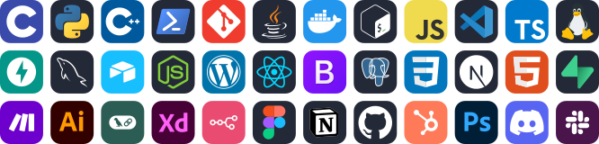

<picture>
  <source media="(prefers-color-scheme: dark)" srcset="https://readme-typing-svg.demolab.com?font=Righteous&weight=400&size=32&duration=3200&pause=1200&color=2DD4BF&center=true&vCenter=true&width=760&height=64&lines=Umma+Habiba+Tuly+here+%F0%9F%94%A5+!;CSE+Engineer;AI+Agents+%26+RAG+Systems;Full-Stack+Developer;Workflow+Automation">
  <source media="(prefers-color-scheme: light)" srcset="https://readme-typing-svg.demolab.com?font=Righteous&weight=400&size=32&duration=3200&pause=1200&color=0F766E&center=true&vCenter=true&width=760&height=64&lines=Umma+Habiba+Tuly+here+%F0%9F%94%A5+!;CSE+Engineer;AI+Agents+%26+RAG+Systems;Full-Stack+Developer;Workflow+Automation">
  
</picture>

---

## Hello 👋 I'm Umma Habiba Tuly

**AI Engineer • Full-Stack Developer • SaaS Builder • UI/UX Designer • Automation Specialist**

🧠 *The IT Mastermind behind the technology.*

## 💫 About Me

🚀 &nbsp;𝗙𝘂𝗹𝗹 𝗔𝗜 𝗦𝗼𝗹𝘂𝘁𝗶𝗼𝗻𝘀: from idea to production. AI agents, RAG knowledge systems and SaaS products, built end to end.

 

⚙️ &nbsp;𝗔𝘂𝘁𝗼𝗺𝗮𝘁𝗶𝗼𝗻: n8n workflows, APIs and webhooks that turn repetitive business work into hands-free systems.

💻 &nbsp;𝗙𝘂𝗹𝗹-𝗦𝘁𝗮𝗰𝗸 𝗦𝗼𝗳𝘁𝘄𝗮𝗿𝗲: web apps and custom software, from polished frontends to solid backends.

🎨 &nbsp;𝗨𝗜/𝗨𝗫 𝗗𝗲𝘀𝗶𝗴𝗻: clean, intuitive interfaces and dashboards that people enjoy using.

🎓 &nbsp;𝗕𝗦𝗰 𝗶𝗻 𝗖𝗦𝗘: North Western University, CGPA 3.70 / 4.00.

📍 &nbsp;Khulna, Bangladesh.

💬 &nbsp;Open to AI, SaaS, software and automation collaborations.

 

### 🌟 Follow Me on:

---

## 🧰 Languages & Tools I Have Placed My Hands On

---

## ⚡ 📊 GitHub Stats

<picture>
  <source media="(prefers-color-scheme: dark)" srcset="https://github-readme-stats.vercel.app/api?username=Umma-Habiba-Tuly&show_icons=true&theme=tokyonight">
  <source media="(prefers-color-scheme: light)" srcset="https://github-readme-stats.vercel.app/api?username=Umma-Habiba-Tuly&show_icons=true&bg_color=FFFFFF&title_color=0969DA&text_color=1F2328&icon_color=1A7F77&border_color=D0D7DE">
  
</picture>
<picture>
  <source media="(prefers-color-scheme: dark)" srcset="https://streak-stats.demolab.com?user=Umma-Habiba-Tuly&theme=tokyonight">
  <source media="(prefers-color-scheme: light)" srcset="https://streak-stats.demolab.com?user=Umma-Habiba-Tuly&background=FFFFFF&ring=0969DA&fire=F59E0B&currStreakLabel=0969DA&currStreakNum=1F2328&sideLabels=0969DA&sideNums=1F2328&dates=57606A&stroke=D0D7DE&border=D0D7DE">
  
</picture>
 
<picture>
  <source media="(prefers-color-scheme: dark)" srcset="https://github-readme-stats.vercel.app/api/top-langs/?username=Umma-Habiba-Tuly&layout=compact&theme=tokyonight">
  <source media="(prefers-color-scheme: light)" srcset="https://github-readme-stats.vercel.app/api/top-langs/?username=Umma-Habiba-Tuly&layout=compact&bg_color=FFFFFF&title_color=0969DA&text_color=1F2328&border_color=D0D7DE">
  
</picture>

---

## 💻 Tech Stack:

---

## ⭐ Top Contributed Repo &nbsp;&nbsp;&nbsp;&nbsp; 💪 Random Dev Quote

<a href="https://github.com/Umma-Habiba-Tuly/tuly-portfolio">
<picture>
  
</picture>
</a>
<picture>
  <source media="(prefers-color-scheme: dark)" srcset="https://quotes-github-readme.vercel.app/api?type=vertical&theme=radical&quoteCategory=programming">
  <source media="(prefers-color-scheme: light)" srcset="https://quotes-github-readme.vercel.app/api?type=vertical&theme=light&quoteCategory=programming">
  
</picture>

---

## 🤝 Let's Work Together

**Need an AI agent, a RAG knowledge base or a workflow that runs while you sleep?**

  

