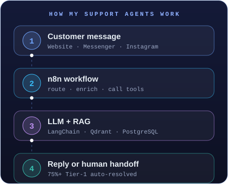

<div align="center">



<br/>

<a href="https://tuly.atsync.tech"></a>
<a href="https://linkedin.com/in/umma-habiba-tuly-cse"></a>
<a href="https://github.com/Umma-Habiba-Tuly"></a>


</div>

---

## 🎯 About Me

```js
const tuly = {
  role: "CSE Engineer",
  location: "Khulna, Bangladesh",
  education: "BSc in CSE, North Western University",

  building: [
    "Hotel AI Receptionist",
    "Multi-channel AI support agents",
  ],

  focus: [
    "AI agents",
    "RAG systems",
    "Workflow automation",
  ],

  stack: {
    languages: ["Python", "TypeScript"],
    backend:   ["FastAPI", "PostgreSQL", "Docker"],
    ai:        ["LangChain", "LlamaIndex", "OpenAI"],
    vector:    ["Qdrant", "Pinecone"],
    automate:  ["n8n", "MCP"],
  },
};
```

<div align="center">



</div>

> *"She is among the most intellectually gifted and diligent students I have encountered in my teaching career."*
> — M. Raihan, Assistant Professor, North Western University (thesis supervisor)

**What I do.** I build production AI agents, RAG knowledge bases and workflow automations for real businesses, from the first prototype to a live system with real customers.

**What shaped me.** A background in **UI/UX design and full-stack development**, so I care about how a system feels to use, not only whether it works.

---

## 🚀 Featured Projects

<table>
<tr>
<td width="50%" valign="top">

### Wear Inspired &nbsp;`LIVE`
**24/7 multi-channel AI customer support**

Website Chat, Messenger and Instagram, with real-time intent analysis, AI Vision product matching and automated human escalation.

**Impact**
- 75%+ Tier-1 auto-resolution
- Under 2.1s response latency

**Tech:** n8n · OpenRouter · Qdrant · PostgreSQL · Meta API · LangChain · FastAPI · Docker

</td>
<td width="50%" valign="top">

### Hotel AI Receptionist &nbsp;`IN DEVELOPMENT`
**Round-the-clock guest assistant**

Handles room availability and FAQ responses over WhatsApp and website chat.

**Goal**
- Cut front-desk call backlogs at peak check-in hours

**Tech:** LangChain · OpenAI · FastAPI · Python · WhatsApp

</td>
</tr>
<tr>
<td width="50%" valign="top">

### Internal Knowledge Base (RAG) &nbsp;`COMPLETED`
**Centralized document search**

Search over internal SOPs and manuals, with cited sources so every answer can be checked.

**Tech:** Pinecone · LlamaIndex · Python · FastAPI

</td>
<td width="50%" valign="top">

### Lead Generation & Outreach &nbsp;`COMPLETED`
**End-to-end lead pipeline**

Scrapes leads, enriches the data, scores prospects with AI and syncs them to the CRM.

**Tech:** n8n · SerpAPI · Google Maps · Google Sheets · OpenRouter

</td>
</tr>
</table>

> Client projects are described, not published. Source stays private.

---

<div align="center">

## 🛠️ Tech Stack

**Languages & Frameworks**


**Data & Vector Search**


**AI & Automation**


**Integrations**


**Web & Design**


</div>

---

<div align="center">

## 📊 GitHub Analytics

<table>
<tr>
<td align="center">

<picture>
  <source media="(prefers-color-scheme: dark)" srcset="https://github-readme-stats.vercel.app/api?username=Umma-Habiba-Tuly&show_icons=true&theme=tokyonight&hide_border=false">
  <source media="(prefers-color-scheme: light)" srcset="https://github-readme-stats.vercel.app/api?username=Umma-Habiba-Tuly&show_icons=true&bg_color=FFFFFF&title_color=0969DA&text_color=1F2328&icon_color=1A7F77&border_color=D0D7DE">
  
</picture>

</td>
<td align="center">

<picture>
  <source media="(prefers-color-scheme: dark)" srcset="https://github-readme-stats.vercel.app/api/top-langs/?username=Umma-Habiba-Tuly&layout=compact&theme=tokyonight">
  <source media="(prefers-color-scheme: light)" srcset="https://github-readme-stats.vercel.app/api/top-langs/?username=Umma-Habiba-Tuly&layout=compact&bg_color=FFFFFF&title_color=0969DA&text_color=1F2328&border_color=D0D7DE">
  
</picture>

</td>
</tr>
</table>

<picture>
  <source media="(prefers-color-scheme: dark)" srcset="https://streak-stats.demolab.com?user=Umma-Habiba-Tuly&theme=tokyonight">
  <source media="(prefers-color-scheme: light)" srcset="https://streak-stats.demolab.com?user=Umma-Habiba-Tuly&background=FFFFFF&ring=0969DA&fire=F59E0B&currStreakLabel=0969DA&currStreakNum=1F2328&sideLabels=0969DA&sideNums=1F2328&dates=57606A&stroke=D0D7DE&border=D0D7DE">
  
</picture>

</div>

---

## 🧭 Background

- **UI/UX Designer**, Logic Line · 08/2022 to 03/2024. Wireframes, design systems and responsive interfaces, working closely with developers.
- **BSc in Computer Science and Engineering**, North Western University · 2020 to 2024 · CGPA 3.70 / 4.00.
- **Thesis:** exam stress detection in university students using activity data and machine learning.

---

<div align="center">

## 💬 Let's Build Something

**Need an AI agent, a RAG knowledge base or a workflow that runs while you sleep?**

<a href="https://linkedin.com/in/umma-habiba-tuly-cse"></a>


</div>
